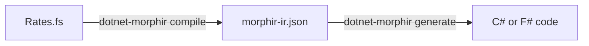

Acme Car Rental keeps its daily rates in F#. In five minutes you turn that rule into
Morphir IR, and then into C# that another team can call.



## 1. Install the tool

You need the [.NET SDK](https://dotnet.microsoft.com/download) 10.0 or later.

```bash
dotnet tool install --global Morphir.Tool --prerelease
dotnet-morphir --version
```

## 2. Write the rule

```bash
mkdir -p acme/src && cd acme
```

Save this as `src/Rates.fs`:

```fsharp
namespace Acme.CarRental

module Rates =
    type VehicleClass =
        | Economy
        | Compact
        | Suv

    let dailyRate (vehicle: VehicleClass) : int =
        match vehicle with
        | Economy -> 4000
        | Compact -> 5000
        | Suv -> 8000
```

## 3. Compile it

```bash
dotnet-morphir compile --language fsharp --input src/Rates.fs --package-name acme/car-rental
```

```text
compile succeeded: 1 module(s), IR version 4, /work/acme/.morphir/out/compile.dest/morphir-ir.json; no diagnostics
/work/acme/.morphir/out/compile.dest/morphir-ir.json
```

The IR is in `.morphir/out/compile.dest/morphir-ir.json`. Every later command can find it there.

## 4. Generate code

```bash
dotnet-morphir generate --target csharp --output generated/csharp
```

```text
p_Acme.CarRental/m_RatesModule.g.cs
```

`generate` reads the IR of the most recent compile, so it needs no `--input`. Use
`--target fsharp` for F#.

Do both steps in one run:

```bash
dotnet-morphir compile --language fsharp --input src/Rates.fs --package-name acme/car-rental \
  --target csharp --generate-output generated/csharp
```

## Next steps

- [Tutorial: car rental pricing from F# to C#]():
  a project file, three modules, a refused construct, a C# app and a CI check.
- [Tutorial: compile F# with the native executable]():
  the AOT `morphir` and the F# frontend extension.
- [What F# can you write?]()
- [`compile` reference]()
