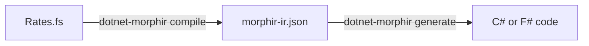

Acme Car Rental keeps its daily rates in F#. In five minutes you turn that rule into
Morphir IR, and then into C# that another team can call.



## 1. Install the tool

You need the [.NET SDK](https://dotnet.microsoft.com/download) 10.0 or later.

```bash
dotnet tool install --global Morphir.Tool --prerelease
dotnet-morphir --version
```

## 2. Write the rule

```bash
mkdir -p acme/src && cd acme
```

Save this as `src/Rates.fs`:

```fsharp
namespace Acme.CarRental

module Rates =
    type VehicleClass =
        | Economy
        | Compact
        | Suv

    let dailyRate (vehicle: VehicleClass) : int =
        match vehicle with
        | Economy -> 4000
        | Compact -> 5000
        | Suv -> 8000
```

## 3. Compile it

```bash
dotnet-morphir compile --language fsharp --input src/Rates.fs --package-name acme/car-rental
```

```text
compile succeeded: 1 module(s), IR version 4, /work/acme/.morphir/out/compile.dest/morphir-ir.json; no diagnostics
/work/acme/.morphir/out/compile.dest/morphir-ir.json
```

The IR is in `.morphir/out/compile.dest/morphir-ir.json`. Every later command can find it there.

## 4. Generate code

```bash
dotnet-morphir generate --target csharp --output generated/csharp
```

```text
p_Acme.CarRental/m_RatesModule.g.cs
```

`generate` reads the IR of the most recent compile, so it needs no `--input`. Use
`--target fsharp` for F#.

Do both steps in one run:

```bash
dotnet-morphir compile --language fsharp --input src/Rates.fs --package-name acme/car-rental \
  --target csharp --generate-output generated/csharp
```

## Compile without .NET installed

The native `morphir` executable has no built-in F# frontend. It starts the F#
frontend as a separate process. The frontend has a self-contained delivery: a
folder with the frontend, the F# compiler service and its own .NET runtime.
With it, compiling F# needs no .NET SDK, no .NET runtime and no `dotnet`
command on the machine.

Releases do not publish this folder yet. Build it from a checkout, on a
machine with the .NET SDK, for the runtime identifier of the target machine:

```powershell
dotnet publish src/Morphir.Frontend.FSharp.Extension -c Release -r win-arm64 -p:PublishProfile=SelfContainedProcess -o morphir-fsharp-frontend
```

The build target `PublishFSharpFrontendProcess --rid <rid>` publishes the same
folder and a zip (Windows) or `.tar.gz` archive of it. Copy the folder to the
target machine and name its executable with `--extension`:

```powershell
morphir compile --language fsharp --input src/Rates.fs --package-name acme/car-rental --extension "C:\Tools\morphir-fsharp-frontend\morphir-fsharp-frontend.exe"
```

What this supports: compiling supported F# source files (`--input`) of one
package to Morphir IR. The compiler references are only the .NET framework,
FSharp.Core and `Morphir.FSharp.Annotations`; there is no NuGet restore and no
reference to another package or assembly. It is not a build of an arbitrary
`.fsproj`, and it does not compile the generated code: building an
application from generated F# or C# still needs the .NET SDK.

Verified on Windows 11 ARM64 (`win-arm64`): the folder runs from a path with a
space, with no `dotnet` on `PATH`, no `DOTNET_ROOT` and an empty NuGet packages
folder. It loads the .NET runtime from its own folder, and it gives the same
IR and diagnostics as the framework-dependent `Morphir.Frontend.FSharp.Extension`
tool. The other platforms are not qualified yet; see
[Installation]().

## Next steps

- [Tutorial: car rental pricing from F# to C#]():
  a project file, three modules, a refused construct, a C# app and a CI check.
- [Tutorial: compile F# with the native executable]():
  the AOT `morphir` and the F# frontend extension.
- [What F# can you write?]()
- [`compile` reference]()
