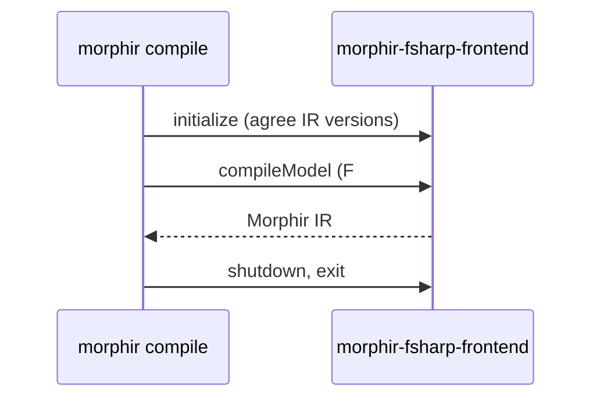

Acme's build agents run the native `morphir` executable: one file, fast to start, and
no `dotnet tool` setup. The native executable has no F# compiler inside. It runs the
F# frontend as an extension, a separate process that it talks to over the Morphir
Extension Protocol (MEP).



This tutorial uses the project from the
[F# pricing tutorial]()
([`examples/car-rental-pricing`](https://github.com/finos/morphir-dotnet/tree/main/examples/car-rental-pricing)).

## 1. Install the executable and the extension

Download `morphir` for your platform from the
[releases page](https://github.com/finos/morphir-dotnet/releases): `morphir-linux-x64`,
`morphir-linux-arm64`, `morphir-osx-arm64` or `morphir-win-x64.exe`.

```bash
VERSION=0.4.0-alpha.3   # the release you want
curl -fsSL -o morphir \
  "https://github.com/finos/morphir-dotnet/releases/download/v$VERSION/morphir-osx-arm64"
chmod +x morphir && mv morphir /usr/local/bin/
```

The F# frontend extension is a dotnet tool. It needs the .NET 10 runtime.

```bash
dotnet tool install --global Morphir.Frontend.FSharp.Extension --prerelease
```

## 2. Try it without the extension

```bash
cd acme
morphir compile
```

```text
error compile.frontend_unavailable: No registered frontend reads the language 'fsharp'. This build registers no frontend. The self-contained and framework-dependent morphir and dotnet-morphir have a built-in F# frontend; this offering uses the F# frontend process delivery morphir-fsharp-frontend. Set [frontend.fsharp].extension in morphir.toml, or use --extension, to configure a frontend extension.
compile failed (configuration, exit code 2); 1 error(s): error compile.frontend_unavailable
```

## 3. Compile with the extension

```bash
morphir compile --extension morphir-fsharp-frontend
```

```text
compile succeeded: 3 module(s), IR version 4, /work/acme/.morphir/out/compile.dest/morphir-ir.json; no diagnostics
/work/acme/.morphir/out/compile.dest/morphir-ir.json
```

The IR is the same, byte for byte, as `dotnet-morphir compile` writes. Classic IR
versions work too:

```bash
morphir compile --extension morphir-fsharp-frontend --ir-version 2
```

## 4. Put it in `morphir.toml`

So that nobody has to remember the option, add the extension to the F# table:

```toml
[frontend.fsharp]
project_file = "Acme.CarRental.fsproj"
extension = "morphir-fsharp-frontend"
```

```bash
morphir compile --json | jq '{success, frontend, extension: .origins.extension.key}'
```

```json
{
  "success": true,
  "frontend": "org.finos.morphir.fsharp-frontend (mep)",
  "extension": "frontend.fsharp.extension"
}
```

`(mep)` shows that the extension did the work. `--extension` on the command line wins
over the key. The value can be a command on `PATH`, a path, or a `.dll`, which runs on
the `dotnet` host.

## 5. When the extension is missing

```text
error extension.unavailable: Extension morphir-fsharp-frontend did not start: An error occurred trying to start process 'morphir-fsharp-frontend' with working directory '/work/acme'. No such file or directory
compile failed (configuration, exit code 2); 1 error(s): error extension.unavailable
```

| Code | Fix |
| --- | --- |
| `extension.unavailable` | Install the extension, or check that it is on `PATH`. |
| `extension.not_admitted` | Request an IR version that the extension serves (1 to 4). |
| `extension.protocol_error` | Update the extension. |
| `extension.timeout` | Read the extension's messages on stderr, then run again. |

## Limits

- `.fsi` signature files: the extension reads `.fs` files only. Use `dotnet-morphir`
  for a project with signature files.
- `generate`, `validate` and the rest of the commands are the same in both executables.

Next: the [`compile` reference](),
or how the [F# frontend runs as an extension]().
