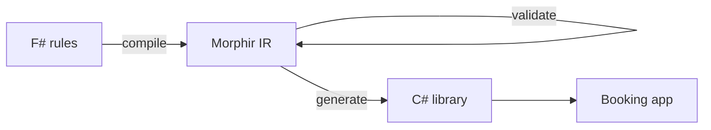

The pricing team at Acme Car Rental writes its rules in F#. The booking team writes C#.
Morphir IR is the contract between them. In this tutorial you build that pipeline.



You need the .NET SDK 10.0 or later and `dotnet-morphir`
([install it]()).
The finished files are in
[`examples/car-rental-pricing`](https://github.com/finos/morphir-dotnet/tree/main/examples/car-rental-pricing).

## 1. Set up the project

The pricing rules live in an ordinary F# project.

```bash
mkdir -p acme/src && cd acme
```

```xml
<!-- Acme.CarRental.fsproj -->
<Project Sdk="Microsoft.NET.Sdk">
  <PropertyGroup>
    <TargetFramework>net10.0</TargetFramework>
  </PropertyGroup>
  <ItemGroup>
    <Compile Include="src/Rates.fs" />
    <Compile Include="src/Quote.fs" />
  </ItemGroup>
</Project>
```

`morphir.toml` tells `compile` what to read, so you do not repeat options:

```toml
# morphir.toml
[project]
name = "acme/car-rental"

[frontend]
language = "fsharp"

[frontend.fsharp]
project_file = "Acme.CarRental.fsproj"
```

The project file gives the file order. F# needs it: `Quote.fs` uses `Rates.fs`.

## 2. Write the rules

```fsharp
// src/Rates.fs
namespace Acme.CarRental

module Rates =
    type VehicleClass =
        | Economy
        | Compact
        | Suv

    let dailyRate (vehicle: VehicleClass) : int =
        match vehicle with
        | Economy -> 4000
        | Compact -> 5000
        | Suv -> 8000
```

```fsharp
// src/Quote.fs
namespace Acme.CarRental

module Quote =
    type Rental =
        { Vehicle: Rates.VehicleClass
          Days: int
          Insurance: bool }

    let insurancePerDay = 1500

    let total (rental: Rental) : int =
        let rentalCost = Rates.dailyRate rental.Vehicle * rental.Days

        if rental.Insurance then
            rentalCost + insurancePerDay * rental.Days
        else
            rentalCost
```

Amounts are in cents.

## 3. Compile

```bash
dotnet-morphir compile
```

```text
compile succeeded: 2 module(s), IR version 4, /work/acme/.morphir/out/compile.dest/morphir-ir.json; no diagnostics
/work/acme/.morphir/out/compile.dest/morphir-ir.json
```

## 4. Add a discount, and meet a refused construct

Product asks for 10% off rentals of a week or more. The first attempt, in `src/Discount.fs`, uses a guard:

```fsharp
namespace Acme.CarRental

module Discount =
    let weeklyDiscount (days: int) (total: int) : int =
        match days with
        | d when d >= 7 -> total * 90 / 100
        | _ -> total
```

Add it to the project file, after `Quote.fs`, and compile:

```xml
    <Compile Include="src/Discount.fs" />
```

```text
src/Discount.fs:6:18: error fsharp.unsupported_pattern_guard: Pattern guards ('when') are not supported; a Morphir pattern has no condition. Match the case, then use 'if' in its body.
compile failed (source, exit code 1); 1 error(s): error fsharp.unsupported_pattern_guard
```

Morphir IR has no guarded patterns, so `compile` refuses the code and tells you what to do.
No IR is written. Follow the hint:

```fsharp
// src/Discount.fs
namespace Acme.CarRental

module Discount =
    let weeklyDiscount (days: int) (total: int) : int =
        if days >= 7 then total * 90 / 100 else total

    let discountedTotal (rental: Quote.Rental) : int =
        weeklyDiscount rental.Days (Quote.total rental)
```

```text
compile succeeded: 3 module(s), IR version 4, /work/acme/.morphir/out/compile.dest/morphir-ir.json; no diagnostics
```

Every refused construct has a code and a fix. See the
[F# coverage reference]().

## 5. Use the rules from C#

```bash
dotnet new console --output BookingApp
dotnet add BookingApp package Morphir.SDK.CSharp --prerelease
dotnet-morphir generate --target csharp --output BookingApp/Generated
```

Replace `BookingApp/Program.cs`:

```csharp
using Acme.CarRental;

var weekTrip = new QuoteModule.Rental(new RatesModule.VehicleClass.Compact(), 7, false);

Console.WriteLine($"Before discount: {QuoteModule.Total(weekTrip)}");
Console.WriteLine($"After discount:  {DiscountModule.DiscountedTotal(weekTrip)}");
```

```bash
dotnet run --project BookingApp
```

```text
Before discount: 35000
After discount:  31500
```

Each F# module becomes a static C# class (`Quote` becomes `QuoteModule`). Records and
union cases become classes with value equality. Do not edit the files in `Generated`;
run `generate` again when the rules change.

## 6. Check the IR in CI

Use `--json` for a machine-readable report. The exit code is 0, 1 (a source error) or
2 (a setup error).

```bash
dotnet-morphir compile --json | jq '{success, modules, diagnostics}'
```

```json
{
  "success": true,
  "modules": [
    "Rates",
    "Quote",
    "Discount"
  ],
  "diagnostics": []
}
```

To run the type validator, compile to classic IR version 3 and validate the result. The
validator does not read IR version 4 yet.

```bash
dotnet-morphir compile --ir-version 3 -o dist
dotnet-morphir validate --input dist/morphir-ir.json
```

```text
0 errors, 0 warnings, 0 info, 0 hints. Analyzers: 1 ran, 0 not run, 0 failed.
```

`-o dist` puts a copy of the IR in `dist` for other teams. It replaces only files that
an earlier compile put there.

## 7. One command for the booking team

```bash
dotnet-morphir compile --target csharp --generate-output BookingApp/Generated
```

```text
compile succeeded: 3 module(s), IR version 4, /work/acme/.morphir/out/compile.dest/morphir-ir.json, generated 3 artifact(s) with morphir.csharp to /work/acme/BookingApp/Generated; no diagnostics
```

## What you built

| Step | Command |
| --- | --- |
| F# rules to IR | `dotnet-morphir compile` |
| IR to C# | `dotnet-morphir generate --target csharp --output <dir>` |
| Both in one run | `dotnet-morphir compile --target csharp --generate-output <dir>` |
| CI check | `dotnet-morphir compile --json`, `dotnet-morphir validate --input <ir>` |

Next: [compile F# with the native executable](),
or read the [`compile` reference]().
