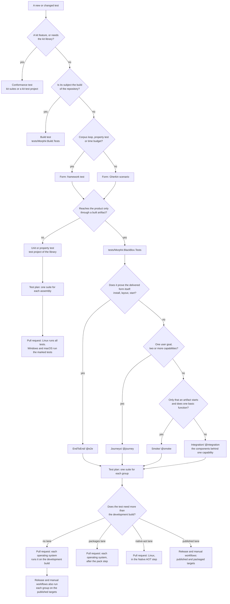
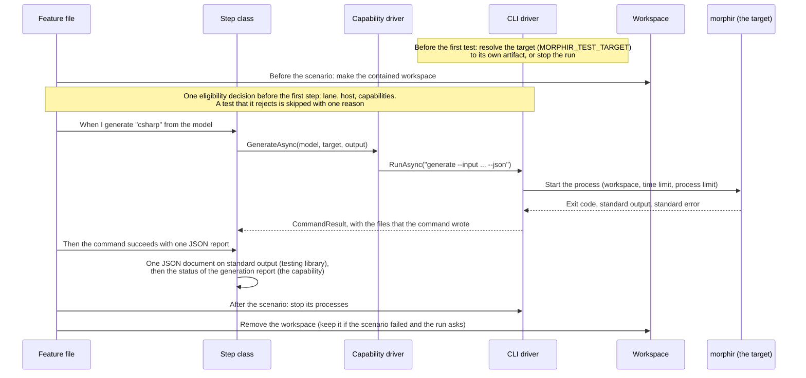

# Proposal

## Why

Black-box tests (tests that use only a built artifact: the CLI, a package, a published executable) are spread
over the test projects, beside unit tests: a source scan finds 128 test files in 25 projects that start a
process, run a build or read a built artifact. In `Morphir.Tooling.Tests`, about 40% of the tests take about 95% of the time, and almost
all of them start the CLI as a process. The CI build cannot select, order or split these tests, because a test
assembly is its smallest unit. Each project also starts and contains the CLI in its own way: `CliTestHelper` in
`Morphir.Tooling.Tests`, `ExecutableRunner` and `ExecutableLocator` in `Morphir.E2E.Tests`, the `cli` adapter of the
compatibility kit, and environment variables such as `MORPHIR_EXECUTABLE_TYPE`, `MORPHIR_GENERATION_CLI` and
`MORPHIR_DOTNET_TOOL_CLI`.

[#612](https://github.com/finos/morphir-dotnet/pull/612) added a `PlatformSpecific` marker to 4,068 tests, so
Windows and macOS run only those. The marked tests are 99% of the test time, because the slow tests are the
black-box ones. A structural rule gives the same result with no mark for each test: the black-box project runs on
each operating system, and unit test projects run on Linux.

An agent that adds a test has no rule that says which kind of test it is, where it goes, or which pattern it must
use. The marker rule is only in a contributor document.

## What Changes

- **One black-box test project**, `tests/Morphir.BlackBox.Tests`, with four groups by purpose:
  `Integration`, `EndToEnd`, `Smoke` and `Journeys`. Each scenario states its group with one tag.
- **Gherkin drives the scenarios** (Reqnroll on TUnit, which the repository uses now). The step vocabulary of this
  project is separate from the step vocabulary of the compatibility kit. Three kinds of test are not Gherkin: a
  loop over a corpus, a property test and a test with a time budget. When such a test reaches the product through
  an artifact, it is a framework test in the black-box project, with a group and with drivers.
- **The group is the purpose, not the target.** A journey that runs against the Native AOT executable is a
  journey. End-to-end is the group for tests of the delivered form itself: installation, layout and start.
- **Test drivers.** A scenario step calls a driver interface, not a process or the file system. A driver owns the
  orchestration: it starts processes, makes the workspace, folders and temporary directories, publishes and
  installs artifacts, and applies the containment and the limits. Each driver states the capabilities that it
  supports.
- **Targets and hosts.** The target of a run is one closed value: the development build, the trimmed, untrimmed
  or Native AOT executable, one of the four packaged offerings, or one executable at a given path. The host is
  the entry point: the native `morphir`, the managed `morphir` or the `dotnet-morphir` tool. The development
  build has the three hosts, and a test that needs one host names it with a tag. The same scenario runs against
  each target that has its host and supports its capabilities. A target never uses the artifact of another form.
- **A testing library**, `tests/Morphir.TestSupport`, holds the driver interfaces, the targets, the workspace and
  the assertions on a command result. It has no reference to a product assembly. The black-box project sees no
  assembly from `src/`, also not through the compatibility kit: a test that needs the kit library in the test
  process is a conformance test and stays in a kit test project.
- **The `Test` target runs the groups as units.** `build/Helpers/TestPlan.cs` selects a group of the black-box
  project as it selects a test assembly now, and `--test-group` runs one group. The scope `platform` runs the
  black-box project in full. The build divides one process limit for the machine among the test processes that it
  starts at the same time, as a fixed share for each.
- **A `test-manager` skill**, with a read-only reviewer agent, for each coding agent that the repository supports.
  It gives the classification of a new test, its location, and the pattern to follow. `AGENTS.md` tells an agent to
  use it when it adds, moves or changes a test.
- **Guard tests** make the rules that a program can check fail the build: a test with no group, a reference
  that makes a product assembly visible to the black-box project, a step that starts a process without a driver
  (a partial check; the reviewer agent has the rule too).
- **The complete migration, in six pull requests.** This change moves all black-box tests.
  `evidence/inventory.md` has each of the 128 files with the pull request that moves it (61) or the reason that
  it stays (67), and the last pull request checks that each row is done. A test of a packed package or an
  installed tool is a black-box test and moves, also from `Morphir.Build.Tests`. A test of a build target, a
  workflow or a build helper is a build test and stays there.
- **Lanes.** A test that needs more than the development build has one lane: `packages` (the packed packages:
  pull request, each operating system, after the pack step, as now), `native-aot` (a Native AOT publish: pull
  request, Linux, as now) or `published` (a published or packaged executable: release and manual workflows). A
  test with no lane runs on the development build in a pull request, in each group, also end-to-end. Pull request 1 has
  the library, the project, the build changes, the guard tests, the skill and the first slice: the CLI integration
  features and the artifact-only cases of the C# generation CLI tests of `Morphir.Tooling.Tests`. Pull requests 2
  to 6 move the other black-box tests. A source project keeps its unit tests.
- **Each discovered test is accounted for.** A move table lists each test that the test runner finds in the
  source, with its new test or the reason that it stays. A test that also needs a product assembly is split: the
  comparison with the product function stays in the unit test project.
- **Library hosts stay programs** for the shipped libraries that the CLI does not reach
  (`Morphir.Configuration.Microsoft`, `Morphir.Conformance`). A driver publishes and runs them, and checks the
  trim and AOT warnings against an allowed list. The Native AOT CLI is tested from a normal test process.
- **A check that a pull request runs now keeps a pull request run.** The package checks and the Native AOT
  checks move to their lanes. The old probe targets stay until their replacements passed in CI.

No product behavior changes. No test is deleted without an equal scenario in the same pull request.

### Flow: where a test goes and how the build runs it

### Sequence: one black-box scenario

The step class never starts a process and never reads the machine. `design.html` has the same two diagrams with
the type names, and the flow of the classification that the `test-manager` skill uses.

## Capabilities

### New Capabilities

- `black-box-test-suite`: the one project for black-box tests, its four groups, the tag rules, the rule that it
  uses only built artifacts, and how the build selects a group.
- `test-driver-contract`: the driver interfaces, the closed set of targets, capabilities and the result of an
  unsupported capability, the workspace that a driver owns, and the assertions on a command result.
- `test-authoring-guidance`: the `test-manager` skill and its reviewer agent: the classification of a test, the
  location and pattern for each class, and when an agent must use the skill.

### Modified Capabilities

None. The product specifications do not change.

## Tracking

- Earlier work: [#612](https://github.com/finos/morphir-dotnet/pull/612) (CI time, the `PlatformSpecific` marker,
  `build/Helpers/TestPlan.cs`, the rules for tests that build source projects in
  `docs/contributing/ci-os-matrix.md`).
- GitHub issue: [#618](https://github.com/finos/morphir-dotnet/issues/618).
- This repository has no Beads database. Tracking is GitHub issues and OpenSpec.

## Impact

- **New:** `tests/Morphir.BlackBox.Tests`, driver types in `tests/Morphir.TestSupport`,
  `.agents/skills/test-manager/` and its copies, reviewer agent files in `.claude/agents`, `.codex/agents`,
  `.github/agents` and `.grok/agents`.
- **Changed:** `build/Helpers/TestPlan.cs` and `build/Build.Testing.cs` (a group of a project is a suite, the
  option `--test-group`, a fixed share of the process limit for each test process, a `TestAot` target in pull
  request 5), a shared MSBuild file that gives a test project the paths of the built CLI,
  `.github/workflows/development.yml` only if a new step is necessary, `scripts/sync-agent-skills.fsx` (one more
  owned skill), `AGENTS.md`, `CLAUDE.md`, `.agents/skills-reference.md`, `docs/contributing/ci-os-matrix.md`,
  `Morphir.slnx`.
- **Moved in pull request 1:** `tests/Morphir.Tooling.Tests/Integration/CLI/` and the artifact-only cases of
  `Features/Generate/CSharpCliGenerationTests.cs`.
- **Moved in pull requests 2 to 5:** `tests/Morphir.E2E.Tests` (11 feature files and 58 framework test methods
  in 13 classes), the CLI features and CLI tests of `Morphir.Tooling.Tests`, the host tests of `Morphir.Tests` and
  `Morphir.Managed.Tests`, `tests/Morphir.Myriad.Integration.Tests`, the package tests, and the checks of the
  smoke hosts and the AOT probes, the five package and installation test files of `Morphir.Build.Tests`, and
  the artifact checks of `Morphir.Toolchain.Tests/GlobalizationTests.fs`.
  `evidence/inventory.md` has the complete list.
- **Environment variables:** `MORPHIR_TEST_TARGET` and `MORPHIR_TEST_HOST` (with `MORPHIR_TEST_EXECUTABLE` for
  one executable at a path) replace `MORPHIR_EXECUTABLE_TYPE`, `MORPHIR_EXECUTABLE_PATH`, `MORPHIR_GENERATION_CLI`,
  `MORPHIR_DOTNET_TOOL_CLI` and `MORPHIR_AOT_CLI`. Each old name keeps its meaning until the pull request that
  moves its tests. `design.html` has the mapping. `MORPHIR_TEST_MAX_PROCESSES` becomes the limit for the complete
  test run.
- **Dependencies:** none new. Reqnroll, TUnit and FluentAssertions are in `Directory.Packages.props`.
- **CI time:** no time is promised. Pull request 1 records the time of `Morphir.Tooling.Tests` before and after
  its CLI tests start the built assembly directly.
