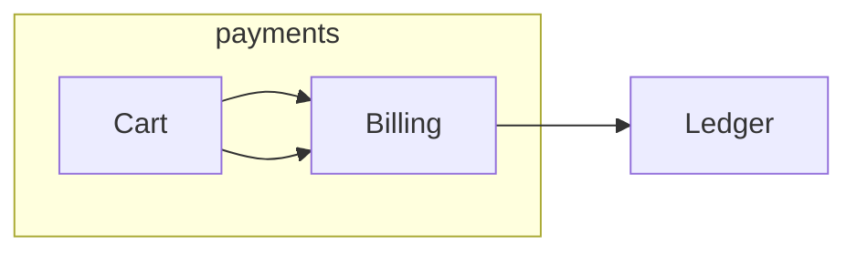

# Morphir.Diagrams

Read Mermaid, PlantUML and BPMN 2.0 into immutable F# models and render them as
standalone SVG and offline HTML players on .NET 10 or .NET 11. The library preserves the original source text, including
its line endings and comments. Parse errors have stable codes and carry
half-open UTF-16 source ranges when a location is available.

## F#

```fsharp
open Morphir.Diagrams

let source = "flowchart LR\n  Read[Read request] --> Valid{Valid?}"

match Mermaid.Parse source with
| Ok document ->
    let rendered = SvgRenderer.Render document.Diagram
    rendered.Output |> Option.ofObj |> Option.iter (printfn "%s")
| Error diagnostics ->
    for diagnostic in diagnostics do
        eprintfn "%O" diagnostic
```

## C#

```csharp
using Morphir.Diagrams;

var source = "sequenceDiagram\n  Customer->>API: Place order";
if (DiagramSource.TryParse(source, out var document, out var diagnostics))
{
    var messages = document.Diagram.Match(
        flowchart: _ => 0, sequence: sequence => sequence.Messages.Length, state: _ => 0, swimlane: _ => 0,
        architecture: _ => 0, railroad: _ => 0, dataTree: _ => 0, bpmn: _ => 0);
    var svg = SvgRenderer.Render(document.Diagram).Output;
}
```

For rendering directly from source, call `Mermaid.RenderSvg(source)`. The
result reports the media type, output, and diagnostics. An input error leaves
`Output` empty and includes a diagnostic.

## Reading any source

`DiagramSource` reads Mermaid, PlantUML or BPMN through one entry point. It detects the
language from the first meaningful text: markup is BPMN, a line that starts with `@` or a
`'` comment is PlantUML, and anything else is Mermaid. `Mermaid` and `PlantUml` read one
language each. Keywords in comments, strings and labels never choose the family.

```csharp
using Morphir.Diagrams;

var language = DiagramSource.Detect("@startjson\n{}\n@endjson");
var rendered = DiagramSource.RenderSvg("stateDiagram-v2\n  [*] --> Draft");
var warnings = rendered.Diagnostics;
```

A known family that the library does not draw, such as `classDiagram` or a class
`@startuml` block, gives an `unsupported-kind` diagnostic. Every reader works within limits
and reports going past one with a code that ends in `-limit`:

| Limit | Value |
| --- | --- |
| Source | 262,144 UTF-16 code units |
| Nesting of subgraphs, composites, frames, blocks and expressions | 64 levels |
| Nodes | 512 |
| Edges and sequence statements | 4,096 |
| Diagnostics | 100 |

A document keeps the exact source it was read from. Accepted text that rendering does not
apply, such as styles, classes, callbacks, links, accessibility text and directives,
gives a warning in `DiagramDocument.Diagnostics` and in the render result; source
configuration never changes the caller's options. PlantUML preprocessor directives such as
`!include` are refused without reading a file or the network.

### Printing

`Mermaid.Print` writes flowcharts and sequences as canonical Mermaid, and
`Mermaid.PrintZenUml` writes sequences as canonical ZenUML. Reading printed text gives the
same model, and printing it again gives the same text. Presentation that the model does not
keep is not printed, and a model that the language cannot write gives diagnostics, never
partial text.

## Offline playback

Call `Mermaid.RenderAnimated(source)` and save the `text/html` output.
The player starts paused and illustrates connections in authored order.
It provides play, pause, restart, step, seek, speed, and SVG download.
Reduced-motion mode supports stepping and seeking, and hidden pages suspend
the playback clock.

The controls are a transport bar fixed to the bottom of the diagram frame.
Each one is an icon button with an accessible name, and the page loads no
font, script or image from outside the file. The play button and the moving
signal use the theme's accent, the readable `cloud` ink. The timeline marks
the start of each scheduled connection. On narrow screens the transport
takes two rows, with the timeline on the second.

`SvgRenderer.BuildScene(diagram)` exposes the immutable
[SVG document](../Morphir.Svg/README.md) and the connector occurrences for
inspection. `AnimatedRenderer.Render(scene)` uses those exact path
definitions, including sequence self-messages and reversed flowchart
connections. Download SVG saves the bytes of the static scene.

Pass a schedule to `AnimatedRenderer.Render(scene, steps)` for finite
playback. Each `PlaybackStep.Create` takes a connector from that scene, a
start time in milliseconds, and a positive duration. Schedule the same
connector more than once for repetition, and overlap intervals for
concurrent playback. A schedule from a different scene is rejected.

Use the viewport toolbar to zoom from 25% to 800%, fit the full diagram, or
enter fullscreen. Drag with a pointer or focus the stage and use the arrow
keys to pan at zoom levels above 100%. Fullscreen uses a page dialog when
native fullscreen is unavailable. Printing lays out the full static diagram.
Style the viewport per player on the `[data-diagram-viewer]` root with the
`--diagram-viewer-height`, `--diagram-viewer-canvas-bg`,
`--diagram-viewer-toolbar-bg`, `--diagram-viewer-border`,
`--diagram-viewer-control-radius`, and `--diagram-viewer-focus` properties.
The page colours are `--diagram-page-bg`, `--diagram-page-text`,
`--diagram-page-muted`, `--diagram-page-surface` and `--diagram-page-accent`,
taken from the selected theme and mode.

Route exploration, rounded and bridged connector routing, and raster
exports are tracked in the migration PRD.

## Themes

Every theme has a dark and a light palette. The built-in themes are
`DiagramThemes.Archify` (the default), `DiagramThemes.Monokai`,
`DiagramThemes.Cobalt`, `DiagramThemes.Solarized`, `DiagramThemes.Gruvbox`,
`DiagramThemes.Ocean`, `DiagramThemes.Darcula` and `DiagramThemes.Material`. Archify is the classic preset of archify, as
diagrams.mbt adapts it. Pass a theme and a mode in `SvgRenderOptions`:

```fsharp
open Morphir.Diagrams

let source = "flowchart LR\n  Cart --> Billing"
let options = SvgRenderOptions.Create(DiagramThemes.Cobalt, ThemeMode.Dark)
let svg = Mermaid.RenderSvg(source, options)
```

```csharp
using System;
using Morphir.Diagrams;

const string source = "flowchart LR\n  Cart --> Billing";
var options = SvgRenderOptions.Default.WithTheme(DiagramThemes.Monokai);
Console.Write(Mermaid.RenderAnimated(source, options).Output);
```

Each built-in theme gives the `backend` family, which most flowchart shapes
take, the accent that the theme is known for, and draws arrows and frames in
a second accent of its own:

| Theme | Services (`backend`) | Decisions (`cloud`) | Arrows and frames |
| --- | --- | --- | --- |
| Archify | Green | Amber | Grey |
| Monokai | Pink | Yellow | Cyan |
| Cobalt | Yellow | Orange | Blue |
| Solarized | Blue | Yellow | Cyan |
| Gruvbox | Orange | Yellow | Blue |
| Ocean | Blue | Yellow | Teal |
| Darcula | Orange | Yellow | Blue |
| Material | Purple | Yellow | Teal |

`ThemeMode.Auto`, the default, writes both palettes. The diagram is dark
unless the viewer prefers light, and a `data-theme="dark"` or
`data-theme="light"` attribute on the root `<svg>` overrides the preference.
`ThemeMode.Dark` and `ThemeMode.Light` write only that palette. The offline
player page takes its background, text, surface and border colours from the
same palette and mode. The `id` and the marker identifiers derive from the
output, so several diagrams can share a page and the same diagram always
produces the same bytes.

### Custom themes

A palette has a background, text, muted text, a mask for the opaque chips
behind labels, an arrow colour, and a fill and stroke for each of the seven
`ColorFamily` values. Subgraph and sequence frame outlines take the muted
colour unless `ThemePalette.WithFrame` gives them their own. The opacity of a
family's fill sets how strongly shapes are tinted. `Color.Parse` and `Color.TryParse` read `#rgb`,
`#rrggbb`, `rgb(r, g, b)` and `rgba(r, g, b, a)`.

```csharp
using System;
using Morphir.Diagrams;

FamilyColors Accent(string stroke, string fill) => FamilyColors.Create(Color.Create(fill), Color.Create(stroke));

var dark = ThemePalette.Create(
    background: Color.Create("#0b1d2a"), text: Color.Create("#f5f7fa"),
    muted: Color.Create("#9db0c2"), mask: Color.Create("#08151f"), arrow: Color.Create("#9db0c2"),
    frontend: Accent("#5ad1e6", "rgba(90, 209, 230, 0.18)"),
    backend: Accent("#7bd88f", "rgba(123, 216, 143, 0.18)"),
    database: Accent("#b39df3", "rgba(179, 157, 243, 0.18)"),
    cloud: Accent("#f2c14e", "rgba(242, 193, 78, 0.18)"),
    security: Accent("#f2727f", "rgba(242, 114, 127, 0.18)"),
    messageBus: Accent("#f59e5b", "rgba(245, 158, 91, 0.18)"),
    external: Accent("#8a9bab", "rgba(138, 155, 171, 0.2)"));

if (!DiagramTheme.TryCreate("Harbour", dark, ThemePalette.DeriveLight(dark), out var theme, out var diagnostics))
    throw new InvalidOperationException(string.Join("\n", diagnostics));

const string source = "flowchart LR\n  Cart --> Billing";
Console.Write(Mermaid.RenderAnimated(source, SvgRenderOptions.Default.WithTheme(theme)).Output);
```

F# callers use `DiagramTheme.Validate(name, dark, light)`, which returns a
`Result`. `DiagramTheme.Create` throws
instead. A theme is rejected with `theme/name` when its name is blank and
with `theme/text-contrast` when either palette's text has less than 4.5:1
contrast with its background. To vary a built-in theme, pass its palettes
to `DiagramTheme.Create`, changing a family with `ThemePalette.WithFamily`.

A family's text colour is derived unless `FamilyColors.Create(fill, stroke,
ink)` sets it. The derived colour is the stroke, darkened on a light
background or lightened on a dark one in 1 percent HSL lightness steps until
it has 4.5:1 contrast with the background and the mask. Flowchart labels sit
on the node fill, so their text must also pass over the fill. An explicit ink
is written unchanged. `ThemePalette.DeriveLight` makes a light palette from
a dark one for themes that supply one mode. The built-in light palettes are
set by hand.

### CSS variables

The SVG references its colours as CSS custom properties. These names are a
public contract:

| Variable | Use |
| --- | --- |
| `--bg` | Canvas and group backgrounds |
| `--text` | Participant names, group titles, edge labels and notes |
| `--muted` | Secondary text |
| `--mask` | Opaque chips behind labels, participant boxes and activation bars |
| `--arrow` | Connectors, lifelines and dotted replies |
| `--frame` | Subgraph outlines, sequence frames and their section dividers |
| `--{family}-fill` | Fills of the family's shapes |
| `--{family}-stroke` | Outlines and message lines of the family |
| `--{family}-ink` | Labels of the family |

`{family}` is the `ColorFamily.WireValue`: `frontend`, `backend`,
`database`, `cloud`, `security`, `messagebus` or `external`. The renderer's
selectors have zero specificity (`:where(svg#id)`), so any host rule that
matches the inline `<svg>` overrides a variable:

```css
.docs svg[data-diagram] { --bg: transparent; --frontend-stroke: #0969da; }
```

Flowchart nodes take a colour family from their shape: decisions and
hexagons are `cloud`, cylinders are `database`, circles are `messagebus`,
and other shapes are `backend`. Groups are dashed outlines in `--frame`. Sequence actors
are `frontend`, and plain participants cycle through `frontend`, `backend`,
`database`, `cloud` and `messagebus`. Requests use their sender's family,
dotted replies use `external` with an `--arrow` line, and messages with a
cross head use `security`. Text uses a monospace font stack and the SVG
embeds no font data.

## Connectors

Graph families (flowcharts, state, swimlane, activity, architecture and BPMN diagrams) draw connectors as elbows by
default. Two options change how they look; neither changes the model, the endpoints or the element references.

| Option | Values | Default |
| --- | --- | --- |
| `WithConnectorStyle` | `ConnectorStyle.Elbow`, `ConnectorStyle.Rounded` (short curves at each bend), `ConnectorStyle.Curved` (one smooth curve) | `Elbow` |
| `WithBridges` | `true` draws a small arc where a connector crosses an earlier one that shares no endpoint with it | `false` |

```csharp
using Morphir.Diagrams;

var options = SvgRenderOptions.Default
    .WithConnectorStyle(ConnectorStyle.Rounded)
    .WithBridges(true);
var svg = Mermaid.RenderSvg("flowchart LR\n  A --> B\n  A --> C", options).Output;
```

Links that leave or enter the same flat side of a box spread evenly along it, and the last segment before an
arrowhead is straight for at least 12 px. The player follows the same final path, arcs included. Curved connectors
get no bridges.

## Element references

Every element of a diagram has a reference that depends only on authored
identifiers and on source order among elements of the same kind. The SVG writes
it as `data-ref` on the element's outermost group, so tools can find an element
in the drawing. Adding an element elsewhere does not change the references of
the others.

| Element | Reference | Example |
| --- | --- | --- |
| Flowchart node | `node=<id>` | `node=Billing` |
| Subgraph | `group=<id>` | `group=payments` |
| Flowchart link | `edge=<source>/<target>/<n>` | `edge=Cart/Billing/1` |
| Participant | `participant=<id>` | `participant=Api` |
| Message | `message=<sender>/<receiver>/<n>` | `message=Api/Db/0` |
| Note | `note=<n>` | `note=0` |
| Frame | `frame=<n>` | `frame=1` |
| Playback step | `step=<n>` | `step=2` |

The ordinal `n` counts from 0 in source order: among links or messages with the
same two endpoints, among all notes, among all frames with outer frames first,
and among playback steps. Within identifiers, `%`, `/`, `=` and every character
that an [RFC 3987](https://www.rfc-editor.org/rfc/rfc3987) IRI fragment does not
allow are percent-encoded as UTF-8, so `node=a%2Fb` names the node `a/b`.
`DiagramElementRef.Parse` and `TryParse` read a reference back, and `Match`
dispatches on its kind.

An element IRI is the diagram's document IRI with the reference as its fragment:
`https://example.org/diagrams/checkout#edge=Cart/Billing/0`. `TryToIri` forms it,
and `TryParseIri` reads it back. A document IRI that already has a fragment is
rejected with `DiagramReferenceError.DocumentHasFragment`.

This flowchart:



has these references, in the order `DiagramElementRef.Enumerate` lists them:

```text
node=Cart
node=Billing
node=Ledger
group=payments
edge=Cart/Billing/0
edge=Cart/Billing/1
edge=Billing/Ledger/0
step=0
step=1
step=2
```

```csharp
using System;
using Morphir.Diagrams;
using Morphir.Knowledge;

const string source = "flowchart LR\n  Cart --> Billing\n  Cart --> Billing";
if (!Mermaid.TryParse(source, out var document, out var diagnostics))
    throw new InvalidOperationException(string.Join("\n", diagnostics));

foreach (var reference in DiagramElementRef.Enumerate(document.Diagram))
    Console.WriteLine(reference);

var second = DiagramElementRef.Create("edge=Cart/Billing/1");
if (!second.TryToIri(Iri.Create("https://example.org/diagrams/checkout"), out var iri, out var error))
    throw new InvalidOperationException(error.ToString());

Console.WriteLine(iri);
```

## Selections, comments and links

A diagram is a knowledge document of `Morphir.Knowledge`. `DiagramSnapshot`
binds a parsed diagram to a `DocumentVersion`, as `TextSnapshot` does for text.
`DiagramSnapshot.TryFromSource` derives the revision from the source: `sha256:`
and the lowercase hex SHA-256 of its exact UTF-8 text, so two parses of the same
text agree, and any edit changes it. `TryCreate` takes a revision you already
have, such as a git blob id. `ElementIri` forms element IRIs, and `TryResolve`
reads one back to an element of the snapshot.

`DiagramSelection` holds one or more elements of one revision, as
`TextSelection` holds ranges. Unknown elements and an empty selection are
`DiagramSelectionError` failures, duplicates collapse, and the elements keep the
order of `DiagramElementRef.Enumerate`. Reading a selection against another
revision is `DiagramSelectionError.VersionMismatch`, and the selection is never
re-resolved silently.

Selections work with the shared `Annotation` and `KnowledgeLink` records. A
comment is an `Annotation<DiagramSelection, string>`. A link from a node to a code
snippet is a `KnowledgeLink<DiagramSelection, TextSelection>`; a link to a web page
uses an `Iri` target, and a link to another diagram uses a `DiagramSelection`.

### F#

```fsharp
open System
open Morphir.Diagrams
open Morphir.Knowledge

let source = "flowchart LR\n  Cart --> Billing\n  Cart --> Billing"
let checkout = DocumentId.Create(Iri.Create "https://example.org/diagrams/checkout")

let snapshot =
    match Mermaid.Parse source |> Result.mapError (fun _ -> "parse") |> Result.bind (fun document ->
        DiagramSnapshot.TryFromSource(checkout, document) |> Result.mapError (fun error -> error.ToString())) with
    | Ok snapshot -> snapshot
    | Error error -> failwith error

let edge =
    match DiagramSelection.TryCreate(snapshot, [ DiagramElementRef.Create "edge=Cart/Billing/0" ]) with
    | Ok selection -> selection
    | Error error -> failwith (error.ToString())

let comment: Annotation<DiagramSelection, string> =
    { Id = AnnotationId.Create(Iri.Create "urn:review:1")
      Target = edge
      Body = "Is this call idempotent?"
      Provenance = { Author = Iri.Create "urn:reviewer:one"; CreatedAt = DateTimeOffset.UtcNow } }

printfn "%s on %O" comment.Body (snapshot.ElementIri edge.Elements[0])
```

### C#

```csharp
using System;
using Morphir.Diagrams;
using Morphir.Knowledge;

const string source = "flowchart LR\n  Cart --> Billing\n  Billing --> Ledger";
if (!Mermaid.TryParse(source, out var document, out var diagnostics))
    throw new InvalidOperationException(string.Join("\n", diagnostics));

var checkout = DocumentId.Create(Iri.Create("https://example.org/diagrams/checkout"));
if (!DiagramSnapshot.TryFromSource(checkout, document, out var snapshot, out var snapshotError))
    throw new InvalidOperationException(snapshotError.ToString());

if (!DiagramSelection.TryCreate(snapshot, [DiagramElementRef.Create("node=Billing")], out var billing, out var selectionError))
    throw new InvalidOperationException(selectionError.ToString());

var code = TextSnapshot.Create(
    new DocumentVersion(DocumentId.Create(Iri.Create("https://example.org/src/Billing.fs")), RevisionId.Create("4be1")),
    "module Billing\nlet charge amount = amount\n");
if (!TextSelection.TryCreate(code, [Morphir.Knowledge.SourceSpan.Create(TextOffset.Create(15), TextOffset.Create(41))], out var snippet, out var textError))
    throw new InvalidOperationException(textError.ToString());

var link = new KnowledgeLink<DiagramSelection, TextSelection>(
    LinkId.Create(Iri.Create("urn:link:billing-impl")), billing, Iri.Create("https://example.org/vocab/implementedBy"), snippet);

Console.WriteLine($"{snapshot.ElementIri(link.Source.Elements[0])} -> {link.Target.Version}");
```

## Comments and links in RDF

`DiagramAnnotations.Write` turns comments and links into RDF statements, and
`DiagramAnnotations.Read` turns them back. Any RDF format of
`Morphir.Knowledge.Rdf` can then carry them, so a sidecar file next to the
diagram and the SVG's own metadata hold the same data.

| Value | RDF |
| --- | --- |
| Comment | An `oa:Annotation` with `oa:motivatedBy oa:commenting`, `oa:bodyValue`, `dcterms:creator` and `dcterms:created` as an `xsd:dateTime` |
| Diagram selection | An `oa:SpecificResource` with the document as `oa:hasSource`, `md:revision`, and one `oa:FragmentSelector` per element, whose `rdf:value` is the element reference |
| Text selection | The same, with one `oa:TextPositionSelector` per range; `oa:start` and `oa:end` count code points, as Web Annotation does, and reading converts them back to UTF-16 offsets |
| Link | An `md:Link` with `md:linkSource`, `md:linkPredicate` and `md:linkTarget`; an IRI endpoint is the IRI itself |
| Direct statement | When a link starts at one element and its target resolves to an IRI, `<element IRI> <predicate> <target IRI>` as well, so that consumers without Web Annotation can query it |

The prefixes are `oa:` for the [W3C Web Annotation vocabulary](https://www.w3.org/TR/annotation-vocab/),
`dcterms:` for DCMI Metadata Terms and `md:` for the Morphir diagram vocabulary,
`https://morphir.finos.org/ns/diagram#`. That IRI is a proposal that the project
owners have not agreed yet; `RdfNamespaces.MorphirDiagram` is the only place
that names it.

Reading needs the revisions that selections name: pass resolvers that return the
`DiagramSnapshot` and `TextSnapshot` of a `DocumentVersion`, or null. A revision
they do not resolve is `DiagramAnnotationError.UnresolvedDocument`. Writing a
text endpoint needs its text too. Reading keeps every statement that belongs to
no comment or link in `DiagramAnnotationSet.Other`, unchanged, such as the
`owner` statement below.

The comment, link and owner fact of the checkout example, as N-Triples:

```n-triples
<urn:review:1> <http://www.w3.org/1999/02/22-rdf-syntax-ns#type> <http://www.w3.org/ns/oa#Annotation> .
<urn:review:1> <http://www.w3.org/ns/oa#motivatedBy> <http://www.w3.org/ns/oa#commenting> .
<urn:review:1> <http://www.w3.org/ns/oa#bodyValue> "Is this call idempotent?" .
<urn:review:1> <http://purl.org/dc/terms/creator> <urn:reviewer:one> .
<urn:review:1> <http://purl.org/dc/terms/created> "2026-11-18T09:00:00Z"^^<http://www.w3.org/2001/XMLSchema#dateTime> .
<urn:review:1> <http://www.w3.org/ns/oa#hasTarget> _:edge .
_:edge <http://www.w3.org/1999/02/22-rdf-syntax-ns#type> <http://www.w3.org/ns/oa#SpecificResource> .
_:edge <http://www.w3.org/ns/oa#hasSource> <https://example.org/diagrams/checkout> .
_:edge <https://morphir.finos.org/ns/diagram#revision> "r1" .
_:edge <http://www.w3.org/ns/oa#hasSelector> _:edgeSelector .
_:edgeSelector <http://www.w3.org/1999/02/22-rdf-syntax-ns#type> <http://www.w3.org/ns/oa#FragmentSelector> .
_:edgeSelector <http://www.w3.org/1999/02/22-rdf-syntax-ns#value> "edge=Cart/Billing/0" .
<urn:link:billing-impl> <http://www.w3.org/1999/02/22-rdf-syntax-ns#type> <https://morphir.finos.org/ns/diagram#Link> .
<urn:link:billing-impl> <https://morphir.finos.org/ns/diagram#linkSource> _:billing .
<urn:link:billing-impl> <https://morphir.finos.org/ns/diagram#linkPredicate> <https://example.org/vocab/implementedBy> .
<urn:link:billing-impl> <https://morphir.finos.org/ns/diagram#linkTarget> _:code .
_:billing <http://www.w3.org/1999/02/22-rdf-syntax-ns#type> <http://www.w3.org/ns/oa#SpecificResource> .
_:billing <http://www.w3.org/ns/oa#hasSource> <https://example.org/diagrams/checkout> .
_:billing <https://morphir.finos.org/ns/diagram#revision> "r1" .
_:billing <http://www.w3.org/ns/oa#hasSelector> _:billingSelector .
_:billingSelector <http://www.w3.org/1999/02/22-rdf-syntax-ns#type> <http://www.w3.org/ns/oa#FragmentSelector> .
_:billingSelector <http://www.w3.org/1999/02/22-rdf-syntax-ns#value> "node=Billing" .
_:code <http://www.w3.org/1999/02/22-rdf-syntax-ns#type> <http://www.w3.org/ns/oa#SpecificResource> .
_:code <http://www.w3.org/ns/oa#hasSource> <https://example.org/src/Billing.fs> .
_:code <https://morphir.finos.org/ns/diagram#revision> "4be1" .
_:code <http://www.w3.org/ns/oa#hasSelector> _:codeSelector .
_:codeSelector <http://www.w3.org/1999/02/22-rdf-syntax-ns#type> <http://www.w3.org/ns/oa#TextPositionSelector> .
_:codeSelector <http://www.w3.org/ns/oa#start> "15"^^<http://www.w3.org/2001/XMLSchema#nonNegativeInteger> .
_:codeSelector <http://www.w3.org/ns/oa#end> "41"^^<http://www.w3.org/2001/XMLSchema#nonNegativeInteger> .
<https://example.org/diagrams/checkout#node=Billing> <https://example.org/vocab/implementedBy> <https://example.org/src/Billing.fs> .
<https://example.org/diagrams/checkout#node=Ledger> <https://example.org/vocab/owner> "payments-team" .
```

## Metadata in the SVG

A rendered SVG can carry a dataset, so that one file holds the drawing and its
comments, links and other statements. Read the dataset from a sidecar file in any
format of `Morphir.Knowledge.Rdf`, then render with the diagram's document and the
dataset:

```csharp
using System;
using System.Text;
using Morphir.Diagrams;
using Morphir.Knowledge;
using Morphir.Knowledge.Rdf;

const string sidecar = "<https://example.org/diagrams/checkout#node=Ledger> <https://example.org/vocab/owner> \"payments-team\" .\n";
if (!NQuads.TryRead(Encoding.UTF8.GetBytes(sidecar), out var dataset, out var readError))
    throw new InvalidOperationException(readError.ToString());

var options = SvgRenderOptions.Default
    .WithDocument(DocumentId.Create(Iri.Create("https://example.org/diagrams/checkout")))
    .WithMetadata(dataset, MetadataEmbedding.RdfXml, NamedGraphHandling.Reject);
var rendered = Mermaid.RenderSvg("flowchart LR\n  Cart --> Billing --> Ledger", options);
foreach (var diagnostic in rendered.Diagnostics)
    Console.Error.WriteLine(diagnostic);

var svg = rendered.Output ?? throw new InvalidOperationException("The diagram did not render.");
if (!DiagramMetadata.TryRead(Encoding.UTF8.GetBytes(svg), out var extracted, out var metadataError))
    throw new InvalidOperationException(metadataError.ToString());

Console.WriteLine($"{extracted.Quads.Length} statement(s) came back from the SVG");
```

The SVG's `metadata` element is its first child. `MetadataEmbedding.RdfXml`, the
default choice, writes an `rdf:RDF` element, the form that SVG and RDF tools
expect. `MetadataEmbedding.NQuads` and `NTriples` write the statements as text in
an `md:dataset` element with a `media-type` attribute. Choose N-Quads when named
graphs matter: RDF/XML and N-Triples hold the default graph only, so a dataset
with named graphs is the error `metadata/named-graphs`, and no output, unless you
pass `NamedGraphHandling.DropNamedGraphs`; each dropped graph is then a
`metadata/dropped-graph` warning.

The renderer writes the dataset canonically (RDFC-1.0), so the same source,
document, dataset and options give identical bytes whatever the blank-node
identities and statement order. A dataset without `WithDocument` is the error
`metadata/missing-document`. A statement or comment about an element IRI of the
document that names no element of this revision, such as a renamed node, is a
`metadata/unknown-element` warning, and the statement is still embedded, so it is
not lost. Without a dataset, the SVG has element references and no `metadata`
element.

`DiagramMetadata.TryRead` finds whichever form is present and returns the
dataset; an SVG without metadata gives an empty dataset. It reads the SVG with
DTDs prohibited and no resolver. The library does not look for sidecar files; a
suggested name is the diagram's file name with `.nq`, `.nt` or `.rdf` appended,
such as `checkout.mmd.nq`.

## Notes in the player

Pass the same options to `Mermaid.RenderAnimated(source, options)`, or pass
`SvgRenderer.BuildScene(diagram, options)` to `AnimatedRenderer.Render`, and the
offline player shows the dataset on the diagram. Each element that has comments, links or other
statements gets a small marker with the number of items: at the top right of a
node, group or participant, and at the middle of an edge or message. Markers keep
one size on screen at every zoom level.

Activate a marker with a pointer, <kbd>Enter</kbd> or <kbd>Space</kbd> to open the
notes panel. The panel lists the element's comments with author, time (in UTC) and
body, then its links, then its other statements, each with the full predicate IRI.
The element is outlined with a dashed frame while the panel is open. Focus or point
at a comment or link that targets more than one element to outline all of them;
the item also names the other elements. <kbd>Esc</kbd> or the close button closes
the panel and returns focus to the marker. The panel docks beside the diagram,
and below it on narrow screens, so it never covers an element.

The player gets a JSON projection of the dataset and never reads RDF. Bodies,
names and values are shown as plain text, so markup in a comment stays literal.
Only `http` and `https` targets are links, and they open in a new tab without a
referrer; any other scheme, such as `javascript:` or `file:`, is shown as text.
Markers, outlines and the panel are not part of the downloaded SVG, and printing
hides them. A player without a dataset has no markers.

## State diagrams

Mermaid `stateDiagram` and `stateDiagram-v2`, and PlantUML state blocks, read into one
`StateDiagram`: states and pseudostates (initial, final, choice, fork, join, shallow and
deep history, entry and exit points), the root region and each composite's regions, ordered
transitions whose `Event`, `Guard` and `Action` are text that is never evaluated, and notes.
`[*]` gives an initial or final state scoped to its region, such as `root::initial` or
`Work::region-1::final`. `Validate` reports duplicate identifiers, missing endpoints, owners and
note targets, ownership cycles and transitions into an initial or out of a final state.
`WithCollapsed` draws a composite as one state; transitions that cross its outline end on it.

| Element | Reference | Drawn as | Colour family |
| --- | --- | --- | --- |
| State | `node=Idle` | Rounded box with its description lines | backend |
| Composite | `group=Work`; each of several regions is a nested `group=Work::region-1` | Dashed box | frame |
| Initial and final | `node=root::initial`, `node=root::final` | Filled dot, ringed dot | external |
| Choice, fork, join | `node=Check` | Diamond, bar | cloud, external |
| History | `node=H1` | Circle with `H` or `H*` | messagebus |
| Transition | `edge=Idle/Busy/0` | Arrow with its label | arrow |
| Note | `node=Idle::note-0` | Folded note joined by a dotted line | external |

All 53 fixtures of the pinned Mermaid reference are accepted or refused as Mermaid 12.2.0
does, with the same states, regions and transitions, and all 122 fixtures of the pinned
PlantUML 1.2026.9 state reference are accepted or refused as PlantUML does, with the same
links. PlantUML blocks may use `||` regions, `[H]`, `[H*]` and `Composite[H]` history, pins and
expansion nodes (read as entry and exit points), direction words in arrows and colour suffixes;
a transition between two concurrent regions of one composite is refused, as PlantUML does.
`Mermaid.Print` and `PlantUml.Print` write canonical text in either language. As Mermaid does, entry and exit points
and floating notes in Mermaid source are kept in the source but not drawn.

## Swimlane and activity diagrams

Mermaid `swimlane-beta` (the flowchart grammar, `TB` by default) and PlantUML activity
diagrams read into one `SwimlaneDiagram`: lanes, steps with a role (action, start, stop, end,
decision, merge, fork, join, note) and connectors with their branch labels. Lanes draw as
parallel bands of equal length across the flow, each holding its steps; steps outside every
lane come first. A repeated subgraph adds to the first one, which keeps its title.

| Element | Reference | Colour family |
| --- | --- | --- |
| Step | `node=order` | by shape: actions backend, decisions cloud, starts, stops and notes external |
| Lane | `group=Sales` | frame |
| Connector | `edge=order/check/0` | arrow |

All 34 fixtures of the pinned Mermaid swimlane reference give the reference steps, lanes and
connectors, and `Mermaid.Print` writes canonical `swimlane-beta` text.

PlantUML activity diagrams read in both dialects. The modern dialect (`start`, `:action;`,
`if`/`elseif`/`else`, `switch`/`case`, `while`, `repeat` with `backward`, `fork` and `split`,
`break`, `stop`, `end`, `kill`, `detach`, `|lanes|`, `partition` and `group`, notes and arrow
labels) becomes structured flow: decisions, merges where branches meet, loop returns and
exits, and bars. The legacy dialect (`(*)`, quoted activities with aliases, `===bars===`,
`if`/`else`/`endif`) is read as written. Mixing the dialects is refused, and labels that load
images are refused without reading anything. All 96 fixtures of the pinned PlantUML activity
reference are read with PlantUML's actions, apart from the four that diagrams.mbt refuses on
purpose. `PlantUml.Print` writes the legacy graph form, in which decisions, merges and lanes
read back as plain activities.

## Architecture diagrams and icons

Mermaid `architecture-beta` reads into an `ArchitectureDiagram`: groups (nested with `in`),
services with an icon or icon text, junctions, edges between ports (`a:R --> L:b`), edges that
attach to a group's outline (`a{group}:R -- L:b`), alignments, and a title. The reader refuses
what Mermaid refuses: an empty `[]` label, an ID that is a port letter, a group used as an
endpoint, a group-boundary edge between members of one group, and an alignment of a group.
Ports place the elements: an edge across the flow orders its ends, and one along it shares a
rank; each edge leaves and enters by its ports. All 18 fixtures of the pinned Mermaid
architecture reference are accepted or refused as Mermaid does, with the same services and
edges, and `Mermaid.Print` round-trips them.

| Element | Reference | Drawn as | Colour family |
| --- | --- | --- | --- |
| Service | `node=api` | Box with its icon above its label | backend |
| Junction | `node=j` | Small circle | external |
| Group | `group=cloud` | Dashed box | frame |
| Edge | `edge=api/db/0` | Line with its heads and label | arrow |

`DiagramIcons.Keys` lists the 526 icon keys, matched without regard to case; a prefix such as
`logos:` is ignored. AWS, Azure, Google Cloud and the UML symbols are copied unchanged from
diagrams.mbt and draw on a light plate so that their colours stay visible in dark themes.
Technology keys, `externalsystem`, `cloud`, `disk`, `internet` and the fallback are drawn for
this library and take the theme's ink. Only the icons a diagram uses enter its SVG, as symbols
with identifiers scoped to the diagram and a title that names the key. An unknown key draws a
dashed fallback and gives a `mermaid/unknown-icon` warning. `THIRD-PARTY-NOTICES.md` in the
package names each provider, its terms and the trademark owners.

## Railroad diagrams

PlantUML `@startregex` and `@startebnf` blocks read into a `RailroadDiagram`: one track for a
regular expression, or one per EBNF rule. Items keep literals, classes, escapes, anchors,
choices, optional parts, repetitions with their bounds, named groups, lookarounds, rule
references, special sequences and exceptions. A reference stays a box; it is never inlined, so
recursive grammars draw. A large bound such as `{2,1000000}` stays a number. The reader refuses
what the library does not draw: atomic groups, inline flags, `\P{…}`, lazy bounded
repetitions and a second rule after a semicolon on one line. All 125 regex and EBNF fixtures of
the pinned PlantUML reference are accepted or refused as PlantUML does, apart from those
deliberate refusals, and `PlantUml.Print` round-trips each accepted one with the same structure.
Both capturing and non-capturing groups print as capturing groups.

Every drawn box has an occurrence identifier, `rule:path` (`track:path` for a regular
expression), where the path lists child positions from the rule's body. Equal text never merges
two boxes. `OccurrenceIds` lists them in drawing order and `OccurrenceOf(item)` finds one.

| Element | Reference | Drawn as | Colour family |
| --- | --- | --- | --- |
| Rule start | `node=number` | The rule's name above its track | text |
| Literal | `node=number:0.1` | Rounded box | frontend |
| Rule reference | `node=number:0.0.0` | Square box | database |
| Escape, anchor, special sequence | `node=track:0.0` | Pointed box | cloud |
| Character class | `node=track:0.2` | Box with `[…]` | messagebus |
| Lookaround, named group, exception | none | Dashed frame with a caption | external, frame, security |

Edges join each box to the boxes that can come straight after it, and each rule's start to its
first boxes, so exploration answers which boxes can follow which. They are not drawn, and the
player visits each rule's start and its boxes in drawing order instead of playing connections.

A matcher or parser outside the library can show its result as a `RailroadTrace`: the outcome,
the visited boxes with their input spans, and the box where matching failed. The library never
matches input itself.

```csharp
using Morphir.Diagrams;

PlantUml.TryParse("@startebnf\nnumber = [ sign ], digit;\n@endebnf\n", out var document, out _);
var model = document!.Diagram.Match<RailroadDiagram?>(
    _ => null, _ => null, _ => null, _ => null, _ => null, railroad => railroad, _ => null, _ => null)!;

var trace = RailroadTrace.Create(
    model,
    RailroadOutcome.NotMatched,
    [RailroadVisit.Create("number:0.0.0", RailroadVisitResult.Matched, 0, 1)],
    failure: "number:0.1");

var svg = SvgRenderer.Render(document.Diagram, SvgRenderOptions.Default.WithRailroadTrace(trace));
```

Matched boxes of a matched trace, the taken prefix of any other outcome, boxes that did not
match and the failure point are separate `data-trace` layers over boxes that do not move. A
trace with nothing to draw gives the same bytes as no trace. A trace made for another diagram
gives `railroad/stale-trace` and one that names a missing box gives `railroad/trace-occurrence`;
neither is drawn.

## Exploring routes and scenarios

Players of diagrams with connections have an *Explore routes* disclosure under the
controls. A reader picks two elements for one shortest route, or one element for what lies
upstream or downstream. Routes follow arrowheads; links without heads are followed only
when the reader asks for them. Results are structural: no guard, condition or timer is
evaluated. `DiagramExploration` gives the same answers in F# and C#:

```csharp
using Morphir.Diagrams;

if (Mermaid.TryParse("flowchart LR\n  A --> B --> C", out var document, out _))
{
    var route = DiagramExploration.Route(
        document.Diagram, DiagramId.Create("A"), DiagramId.Create("C"), LinkFollowing.Arrowheads);
    var upstream = DiagramExploration.Reachable(
        document.Diagram, DiagramId.Create("C"), ExplorationDirection.Upstream, LinkFollowing.Arrowheads);
}
```

A scenario is a finite schedule of `PlaybackStep` connector occurrences, which may repeat
and overlap, and `NodeVisit` highlights of any element, passed to
`AnimatedRenderer.Render(scene, steps, visits)`. A diagram with nothing to play visits its
elements in order.

## Migration coverage

| Mermaid family | Supported syntax |
| --- | --- |
| Flowcharts | The Mermaid 12.2.0 grammar: every fixture of the pinned reference is accepted or refused as Mermaid does, with the same nodes and edges. The shape catalogue is drawn with the nearest built-in shape. Links to subgraphs end on the subgraph's box |
| Sequences | All 38 Mermaid 12.2.0 examples: participant kinds (boundary, control, entity, database, collections, queue), aliases, boxes, create and destroy, central connections, every arrow and half-arrow, notes, activations, frames, and `autonumber` with a start and step |
| States | All 53 fixtures of the pinned Mermaid state reference; see [State diagrams](#state-diagrams) |
| Swimlanes | All 34 fixtures of the pinned Mermaid swimlane reference; see [Swimlane and activity diagrams](#swimlane-and-activity-diagrams) |
| Architecture | All 18 fixtures of the pinned Mermaid architecture reference; see [Architecture diagrams and icons](#architecture-diagrams-and-icons) |
| ZenUML | All 25 pinned ZenUML core 3.47.9 examples, read into the sequence model: annotators, asynchronous messages, calls with bodies, creation, assignments, returns and replies, loops, `if`/`else`, `opt`, `par` and `try`/`catch`/`finally` |

The sequence model exposes ordered `Events` at the root and in each frame
section. `Messages` and `Notes` include nested items in source order.
`par_over` sections use the same vertical layout as `par`.

The native .NET layout produces deterministic, script-free SVG. It shares the
upstream theme but uses its own, simpler layout. Source preservation
includes comments, front matter and directives.

Mermaid styles, classes, callbacks, links and subgraph directions are kept in the source
and reported, not drawn.
The [migration PRD](../../docs/content/contributing/design/prds/migrate-diagrams.md)
tracks the other formats and renderer features.

The reference implementation is [diagrams.mbt](https://github.com/moonrockz/diagrams.mbt/tree/60a8dd19f386b6fc65e9ddf5ddccec213c622d07),
licensed under Apache-2.0.
