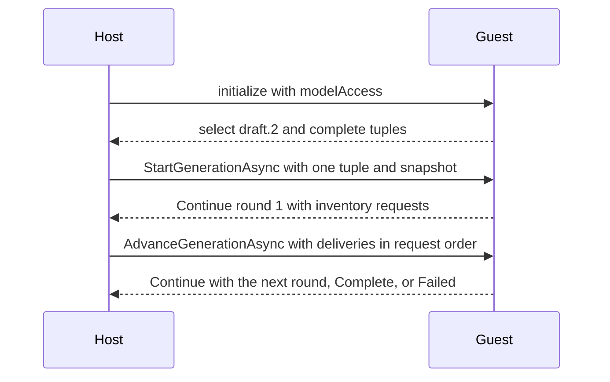

# Morphir.Mep

The Morphir Extension Protocol SDK for morphir-dotnet hosts and guests provides
JSON-RPC 2.0 messages, `Content-Length` framing, the session lifecycle and model
transport on MEP `0.2.0-draft.1`. Bounded generation is an explicit opt-in to
MEP `0.2.0-draft.2`. The core SDK is tracked by
[#512](https://github.com/finos/morphir-dotnet/issues/512) and
[`add-mep-core`](../../openspec/changes/archive/2026-11-09-add-mep-core/proposal.md). The roadmap is the
[Morphir extension model PRD](../../docs/content/contributing/design/prds/morphir-extension-model.md), step 1.

## Layers

| Layer | File | What it does |
| --- | --- | --- |
| Wire types | `Wire.fs` | Records and unions of the pinned contract, with parsed values (`ProtocolVersion`, `SemanticVersion`, `Sha256Digest`, `RequestId`). `MepJson` is generated from this file at build time by `Morphir.Myriad.SystemTextJson`. There is no reflection serializer. |
| Model transport | `ModelTransport.fs` | Tuple selection, the host check of a selection, envelope creation and admission. Pure functions. |
| Bounded generation | `ModelAccess.fs` | Complete tuple selection, start admission and the per-connection operation and round ledger. |
| Message codec | `Rpc.fs` | Classifies a JSON-RPC message by its members (`JsonRpcMessage`), keeps params raw, and writes messages. This is the only hand-written JSON. |
| Dispatcher | `Dispatcher.fs` | `DispatchAsync(bytes, ct)` returns the reply bytes, or none for a notification. A method table maps method names to typed handlers; a gate refuses a method before its handler runs. |
| Framing | `Framing.fs` | `Content-Length` frames on a `Stream`: header blocks up to 8192 bytes, bodies up to 64 MiB, checked before the body is read. A refused frame ends the connection. |
| Connection | `Connection.fs` | Reads frames, dispatches inbound requests concurrently, matches inbound responses to the pending-request table, and sends and receives `$/cancelRequest`. |
| Session | `Session.fs` | The pure lifecycle rules (`Lifecycle.admit`) and version negotiation, shared by hosts and guests. |
| Channel | `Channel.fs` | How a host session reaches its guest: a framed stream pair, or `ISingleMessageChannel` for a guest that takes one message per call. `SessionFailure` says why a single-message session ended. |
| Peers | `Peers.fs` | `Guest` (lifecycle methods, gate, extension methods) and `HostSession` (refuses to send what the guest must refuse). |

On the guest side, the stream path (`Connection`) and the single-message path
(`Dispatcher.DispatchAsync`) use the same dispatcher, so they give the same bytes. On the
host side, `HostSession` holds a channel and applies the same lifecycle, version and
model-transport rules on either. Starting a guest process is not in this project: a process
host connects a `HostSession` to the child's streams.

## Channels

A host session sends a request and waits for its reply, and sends notifications. It does
both through a channel ([CHAN-1](../../openspec/changes/add-wasm-extension-host/design.html#chan-1)).
`HostSession` checks each request against the lifecycle state before it uses the channel, so
a request refused on one channel is refused on the other with the same error, and the guest
never receives it.

| Channel | Constructor | What the guest is |
| --- | --- | --- |
| Framed stream pair | `HostSession(input, output, host, offer)` | A process with `Content-Length` frames on its standard streams. Requests run concurrently and are matched by id; a cancelled request sends `$/cancelRequest`; the guest can send `morphir.progress`. |
| Single message | `HostSession(channel, host, offer)` | A guest that takes one whole message per call, such as the `handle` export of a WASM guest. The runtime implements `ISingleMessageChannel`; `tests/Morphir.Mep.AotProbe` has a C# implementation. |

`ISingleMessageChannel` has two members. Both take the method name, the bytes of one
complete UTF-8 JSON-RPC message with no `Content-Length` header, and a cancellation token.
Both return the bytes of the message the guest returned, or `null` when it returned none.

- `RequestAsync` calls the guest with a request.
- `NotifyAsync` calls the guest with a notification, or withholds it when the guest's
  runtime does not deliver notifications to that guest. A withheld notification does not
  call the guest. `HostSession` always sends `morphir.initialized` and `morphir.exit`; the
  runtime decides whether the guest receives them.

The implementation passes bytes and does not check them. `HostSession` applies these rules
to a single-message guest:

- One call at a time. A request waits until no other call is inside the guest.
- A request takes exactly one reply: the response or error response with the request's id.
  No bytes, a response for another id, a request or notification (such as
  `morphir.progress`), bytes that are not a JSON-RPC message, or a reply over
  `ContentLengthFraming.MaxBodyBytes` fail the session.
- A notification takes no reply. Bytes returned for one fail the session.
- The host never sends `$/cancelRequest`. When a request's token is cancelled, the channel
  stops the call and ends it with `OperationCanceledException`. The request ends with
  `-32800` and the session ends.
- An exception from the channel fails the session.
- After the session fails, no message reaches the guest. `Failure` (C#: `FailureOrNull()`)
  says why, as a `SessionFailure`. The request that failed gets `-32800` when it was cancelled
  and `-32603` otherwise. Later requests get `-32603` without a call. A failure during
  `InitializeAsync` gives `InitializeFailure.Refused` with that error. `RunAsync` ends with
  `Stopped` at exit or failure.

Which notifications a WASM guest accepts is read from its `morphir.initialize` result by
the runtime, not by `HostSession`. The member that advertises it is not fixed in the
contract yet ([NTFY-1](../../openspec/changes/add-wasm-extension-host/design.html#ntfy-1)).

## A guest and a host in memory

This example is compiled by `tests/Morphir.Mep.Tests/ReadmeTests.fs`. Keep the two equal.

```fsharp
let runSession (claims: CapabilityClaimSet) (capabilities: ExtensionCapabilities) =
    task {
        let guest =
            Guest(
                { Claims = claims
                  Capabilities = capabilities
                  Methods = readOnlyDict [] }
            )

        let toGuest = Pipe()
        let toHost = Pipe()
        let guestRun = guest.RunAsync(toGuest.Reader.AsStream(), toHost.Writer.AsStream(), CancellationToken.None)

        let host =
            HostSession(
                toHost.Reader.AsStream(),
                toGuest.Writer.AsStream(),
                { Kind = PeerKind.Cli; Name = "morphir"; Version = "0.4.0" },
                null
            )

        let hostRun = host.RunAsync CancellationToken.None
        let! session = host.InitializeAsync CancellationToken.None
        let! ping = host.PingAsync CancellationToken.None
        let! _ = host.ShutdownAsync CancellationToken.None
        do! host.ExitAsync()
        let! guestEnd = guestRun
        toHost.Writer.Complete()
        let! _ = hostRun
        return session, ping, guestEnd
    }
```

## Bounded generation

An extension can generate from a package on disk without receiving the whole
package at initialization. It asks for the inventory or documents it needs in
each continuation. The host keeps the snapshot lease and answers from the same
revision. The same exchange works on a framed process connection and a WASM
byte-call channel.



Construct the host with `HostSession.CreateWithModelAccess`, supplying
`ModelAccessSupport` and an optional legacy transport offer. The guest lists
draft.2 in `Claims.ProtocolVersions` and declares `Capabilities.ModelAccess`,
its backend targets and its start, advance and cancel handlers. Check the
selected draft and tuple in `InitializeAsync` before choosing the request's
input. A draft.1 selection keeps the existing whole-model path.

For example, when a continuation has no requests, the host advances with an
empty delivery list. This example is compiled by `ReadmeTests.fs`.

```fsharp
let advanceEmpty (host: HostSession) (step: ModelAccessStep) cancellation =
    match step with
    | ModelAccessStep.Continue(id, round, requests, _, _) when requests.Count = 0 ->
        Some(host.AdvanceGenerationAsync({ SessionId = id; Round = round; Deliveries = [||] }, cancellation))
    | _ -> None
```

For a nonempty continuation, supply one delivery per request in order.
`CancelGenerationAsync` requests release of an open operation and checks the
acknowledged ID. An invalid round does not consume the outstanding round.
Completion, failure and an acknowledged cancel retire the operation ID for the
connection. Both peers check exchange identity and order. Before passing a
document delivery to the transport or handler, they verify canonical base64,
decoded length, and SHA-256. They enforce the batch document count and the
aggregate encoded and decoded byte ceilings before decoding. An invalid
delivery leaves the pending round available for correction. Snapshot access,
IR decoding, execution deadlines, artifact staging, and publication belong to
the host and extension operating the session.
See the [bounded-generation contract](https://github.com/finos/morphir/blob/177371fa7a6199b7f177a8c1d886f583ee57e813/spec/mep/model-access.md)
for the complete exchange and resource limits.

## Add a method

1. Check that the pinned contract has the method and its params and result types. Do not
   add a method, member or error code that the pin does not have; raise an upstream issue.
2. Write a failing wire test, then add the types to `Wire.fs` with the attributes that the
   contract's wire rules need. Add the type to the contract test (`ContractTests.fs`):
   a complete sample, and the members that the contract text lets a reader default.
3. Add the method to `Method` if it is new, and its capability to `Lifecycle.capability`
   if the contract makes it depend on one (the guest replies `-32013` without it).
4. Register a handler in the guest's `Methods` with `Handlers.request` (params bind as one
   object through their codec; absent or mismatched params give `-32602`), and add a typed
   call to `HostSession` if hosts send it.
5. Add the method to the AOT probe (`tests/Morphir.Mep.AotProbe`) when it changes what
   C# calls.

## The pin

[`tests/Fixtures/Mep`](../../tests/Fixtures/Mep/PROVENANCE.md) pins the upstream
contract model (`mep.ir.json`), the transcripts and the model-transport corpus by commit
and digest. Do not edit the fixtures. To update the pin:

1. Copy the new files from `finos/morphir` at one commit, and record the commit and the
   SHA-256 digests in `PROVENANCE.md`.
2. Run the tests. `ContractTests` fails for each renamed or added member, and the
   transcript and corpus tests fail for each changed behavior.
3. Change the types and rules in the same pull request. A new MEP version moves every MEP
   part in morphir-dotnet together; drafts match only exactly.

Where a transcript and the contract text disagree, the tests follow the contract text.
The legacy transcripts initialize with `0.1`; the replays use `0.2.0-draft.1` instead.
The separately pinned bounded-generation transcript runs on exact draft.2.

## C# callers

The project is trimmable and AOT-compatible, with F# nullness metadata. Parsed values have
`TryParse` and `Create`; `FrameRead` and `SessionFailure` have `Match`.
`tests/Morphir.Mep.AotProbe` is a C# consumer that runs the full session on streams and on a
C# `ISingleMessageChannel`; `InteropTests` and `ChannelTests` compile C# examples and check
the nullable-flow diagnostics.

## Tests

```sh
dotnet run --project tests/Morphir.Mep.Tests -- --summary
./build.sh --target TestAot --configuration Release
```

The first command runs the wire, contract, JSON-RPC, connection, session, channel and
model-transport tests in memory. The channel tests use a fake single-message guest built on
`Dispatcher.DispatchAsync`. The second is the Native AOT lane of the black-box tests: it publishes
the probe (and the other probes and library hosts) with Native AOT, refuses IL diagnostics other
than the FSharp.Core summary baseline, and compares the native output with the managed output.
Both run in PR CI.
