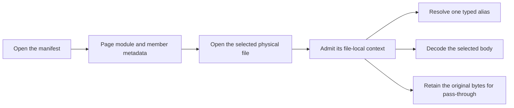

# Reading a contextual document tree

The orders generator can page the module inventory, select the final value,
and resolve its reference to `acme/orders:domain#order` while the referenced
value file stays closed. The reader preserves the IR version and the package
definition or dependency specification role at each selection.



Use `DocumentTreeStore.openSnapshotWithEncoding` with
`BoundedTreeEncoding.ContextualDraft1` for the exact draft.1 envelope in
v3.1 or v4 JSON or YAML. The ordinary `openSnapshot` entry point accepts
plain files. An opted-in snapshot can mix plain and contextual files within
its declared JSON or YAML profile. The provider must supply an immutable
revision or hold a read lease for the snapshot's lifetime.

For example, select the final value from the second orders page and ask for
the v4 reference to `order`.

```fsharp
let referencePath = [| "Public"; "ExpressionBody"; "body"; "Reference" |]
let orderReference =
    DocumentTreeStore.resolveMemberAlias finalValueAddress referencePath snapshot
```

Object names and canonical zero-based array indices identify a slot within the
selected payload. The result is the version's ordinary spelling, a canonical
string in v4 or classic word arrays in a classic v3 slot. The surrounding body
is validated when read through `readMember`. An inline selection uses the
containing module's context. Each split file uses its own table.

The general reader admits the context from the capped physical document before
visiting the selected payload. It can therefore accept context-last documents.
`ContextualDraft1Streaming` additionally requires the schema marker and full
context ahead of the payload. This option enforces wire order. Both options
retain at most the physical files needed for the current selection and apply
the document byte ceiling before parsing and during expansion. YAML also
enforces its profile's syntax, nesting and event limits.

`readMemberWithArtifact` returns the decoded body alongside the original
encoded bytes of the selected split file or containing inline module.
Pass those bytes through to preserve optional members and source spellings.
Aliases in typed positions resolve through their own table. Literal values,
documentation and opaque extension data keep their contents. Morphir's
file-local tables apply to IR documents. Ion symbol tables belong to the
separate Ion codec.

A bounded session can call `DocumentTreeStore.readDocument` with `manifest`
or a logical document ID announced by inventory. The reader checks the ID
against the snapshot before it opens a file. It returns the selected
document's original bytes, including the full local context when present.
Inline members use their containing module's ID. A revision change or a
physical filename in place of a logical ID is refused.


## Stage an expanded JSON tree

Use `DocumentTreeStore.readExpandedDocument` to export a logical document
as plain JSON. The supplied output byte limit is separate from the admitted
input limit. YAML trees export with JSON filenames. Inline bodies use their
containing module's logical document ID.

`DocumentTreeStore.writeExpandedTree` calls a private staging writer once
for each admitted file. It pages the root package and its dependencies, keeps
only the current documents and pages, and enforces per-document and total
UTF-8 byte limits. The caller publishes only after the walk succeeds. A late
read error, failed write or revision change can make the stage incomplete.

Use `readDocument` to keep the exact original bytes, including YAML
presentation and optional envelope data. `readDocumentWithin` applies an
additional cap to those bytes while module inventory still uses the
snapshot's admission budget. During export, the per-document output cap can
also admit a larger expanded inventory without raising the source-byte cap.
